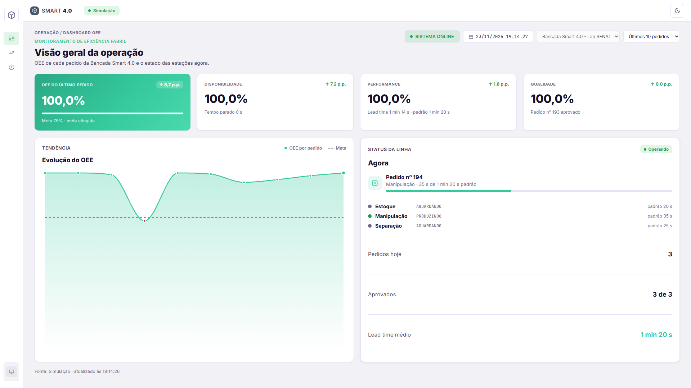
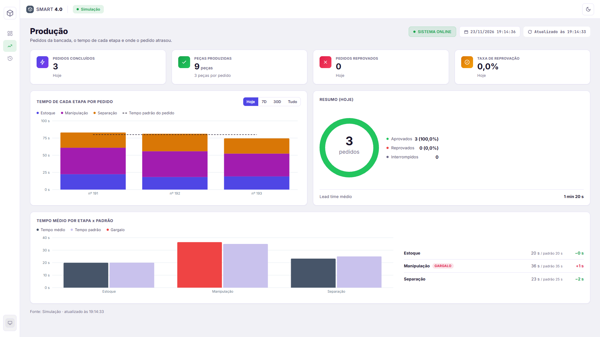
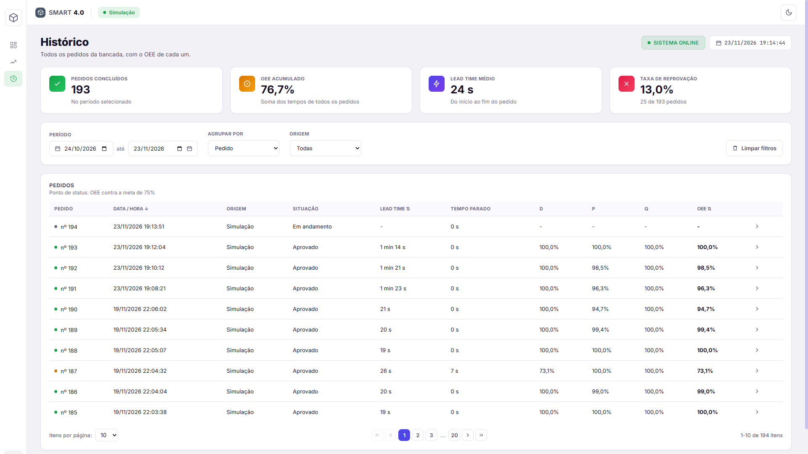
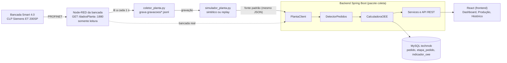

# TechMob 4.0 — Toyota do Brasil

> **Projeto Integrador Interdisciplinar II — Curso Superior de Tecnologia em Análise e Desenvolvimento de Sistemas.**
>
> **Equipe:** Lucas · Nykolas · Otávio · Rafael · Samuel

## Objetivo

O TechMob 4.0 monitora a **Bancada Smart 4.0** do laboratório (CLP Siemens ET 200SP). A cada segundo ele lê o estado da bancada no `GET /dadosPlanta` (do Node-RED dela ou do simulador, que responde o mesmo JSON), identifica cada pedido de 3 peças, calcula o **OEE por pedido** (Disponibilidade × Performance × Qualidade) e mostra tudo num dashboard web.

| Eixo da demanda | Como o TechMob atende | Onde |
|---|---|---|
| Monitoramento de processos | Status das 3 estações (Andon) e pedido em andamento, atualizados a cada 2 s | Dashboard |
| Análise de dados | OEE por pedido e tempo de cada etapa comparado ao tempo padrão | Produção, Histórico |
| Apoio à tomada de decisão | Alerta quando o pedido passa do padrão ou o OEE fica abaixo da meta; estação gargalo em destaque | Dashboard, Produção |
| Aplicação em ambiente produtivo | Contrato e regras tirados da bancada real: o JSON do `/dadosPlanta`, o flow do Node-RED e o CLP ET 200SP ([fotos](docs/img/)); o simulador reproduz esse JSON com a cronometragem da equipe | Simulador e backend |

## Telas

| Dashboard | Produção | Histórico |
|---|---|---|
|  |  |  |

O que cada painel mostra está em [`frontend/README.md`](frontend/README.md#telas).

## Arquitetura



- **A fonte é o Node-RED da bancada, e ele só é lido.** O backend consulta `GET /dadosPlanta` a cada 1 s; nada é instalado ou alterado na bancada ([`node-red/README.md`](node-red/README.md)).
- **O simulador entrega o mesmo JSON.** Para o backend, trocar a bancada pelo simulador é só trocar a URL. Cada pedido grava a origem do dado: `BANCADA`, `REPLAY` ou `SINTETICO`.
- **O OEE é calculado em um lugar só: o backend.** O Python fica com a coleta, a simulação e a análise das gravações, e serve de conferência do cálculo.
- **A fonte padrão é o simulador da bancada**, montado sobre o JSON lido no `/dadosPlanta` em 14/09/2026 e a cronometragem da equipe (20 s, 35 s e 25 s por etapa). O backend lê a bancada real ou o simulador sem mudar uma linha de código: só a `PLANTA_URL`.

| Camada | Tecnologia | Responsabilidade |
|---|---|---|
| Fonte de dados | Bancada Smart 4.0, Node-RED da bancada | Estado das estações e contadores, em `GET /dadosPlanta` |
| Simulação e coleta | Python (biblioteca padrão) | Simular a bancada com o mesmo JSON do `/dadosPlanta`, gravar e reproduzir execuções ([`data/`](data/README.md)) |
| Back-end | Java 25, Spring Boot, Spring Data JPA | Ler a bancada, identificar os pedidos, calcular o OEE, gravar e servir a API REST ([`backend/`](backend/README.md)) |
| Persistência | MySQL 8 local | Máquina, pedidos, etapas, indicadores e leituras brutas |
| Front-end | React, Vite, Axios, Recharts | Dashboard, Produção e Histórico ([`frontend/`](frontend/README.md)) |
| Análise | Python (pandas) | OEE de uma gravação e cronometragem do tempo padrão ([`data/`](data/README.md)) |

## Como o OEE é calculado

O OEE é **por pedido**, não por turno. Para cada pedido: L = lead time (início ao fim), T_parado = soma das paradas, T_padrão = soma do tempo padrão das etapas.

- D = (L − T_parado) ÷ L
- P = mín(1; T_padrão ÷ (L − T_parado))
- Q = 1 se o pedido foi aprovado, 0 se foi reprovado
- OEE = D × P × Q

Exemplo: padrão de 80 s, pedido de 100 s com 12 s parado → D = 88%, P = 80 ÷ 88 = 90,9%, Q = 100%, **OEE = 80,0%**.

Para vários pedidos, o OEE acumulado **soma os tempos** de todos e aplica a mesma fórmula uma vez; não é a média dos OEEs. As regras que identificam o pedido no JSON da bancada estão em [`data/README.md`](data/README.md#como-um-pedido-é-identificado).

## Estrutura do repositório

```
toyota-techmob/
├── backend/             # API Spring Boot e coleta da bancada  → backend/README.md
├── frontend/            # Dashboard React + Vite              → frontend/README.md
├── data/                # Python: coletor, simulador e análise → data/README.md
│   ├── coletor_planta.py          # grava o /dadosPlanta em gravacoes/*.jsonl
│   ├── simulador_planta.py        # serve o mesmo JSON (sintético ou replay)
│   ├── ciclo_padrao.json          # tempo padrão das etapas e textos de status
│   ├── oee_calculator.py          # OEE por pedido de uma gravação (conferência)
│   ├── analisar_cronometragem.py  # tempo padrão real e gargalo
│   └── tests/                     # pytest
├── node-red/            # documentação do Node-RED da bancada (somente leitura)
├── infra/
│   └── schema.sql                 # tabelas + seed da BANCADA_SMART_01 (id = 1)
├── docs/
│   ├── PLANO_ALINHAMENTO.md       # plano da equipe: decisões, contrato e ordem de execução
│   ├── entregas/                  # relatório ABNT, roteiro do pitch e o deck de slides (.pptx)
│   └── img/                       # fotos do laboratório (14/09/2026) e capturas das telas
└── README.md
```

## Pré-requisitos

- JDK 25 (o Maven vem junto, pelo wrapper `mvnw`)
- Node.js 20+ e npm
- Python 3.11+ (o coletor e o simulador usam só a biblioteca padrão; a análise usa pandas)
- MySQL 8 (Server + Workbench)

## Como rodar (do zero)

Cada parte roda num terminal separado, na ordem do caminho do dado.

### 1. Banco de dados

Execute [`infra/schema.sql`](infra/schema.sql) no MySQL Workbench (ou, no PowerShell, `Get-Content infra/schema.sql | mysql -u root -p`). O script cria o banco `techmob`, as tabelas e a máquina `BANCADA_SMART_01` com `id = 1`.

Se você já tinha o banco da versão anterior (com `historico_producao`), recrie: o banco é local e ainda não tem dado real.

```sql
DROP DATABASE techmob;
```

e rode o `schema.sql` de novo.

A senha do banco vem do ambiente (os outros dados têm padrão; ver [`backend/README.md`](backend/README.md#variáveis-de-ambiente)):

```powershell
$env:DB_PASSWORD = "sua-senha"
```

### 2. Fonte de dados: o simulador da bancada

Suba o simulador, que responde na mesma rota e com o mesmo JSON da bancada (`http://localhost:1880/dadosPlanta`, o padrão do backend):

```powershell
python data/simulador_planta.py                                             # pedidos sintéticos
python data/simulador_planta.py --modo replay --gravacao data/gravacoes/<sessao>.jsonl   # reproduz uma gravação
```

**Com a bancada real ligada**, aponte o backend para o Node-RED dela (passo 3) com `PLANTA_URL=http://<IP do Node-RED da bancada>:1880/dadosPlanta` e deixe o simulador de reserva na porta 1881 (`--porta 1881`): depois de 3 falhas seguidas na bancada, o backend passa a ler o simulador (`PLANTA_URL_FALLBACK`). Para gravar uma execução, use `python data/coletor_planta.py --url http://<IP>:1880/dadosPlanta`. Detalhes em [`data/README.md`](data/README.md).

### 3. Backend (coleta e API)

```powershell
cd backend
.\run-local.cmd          # pede a senha se DB_PASSWORD não estiver definida
```

- API: http://localhost:8080
- Health check: http://localhost:8080/actuator/health
- O log mostra cada pedido identificado: `Pedido 12 concluído em 97 s: OEE 80.000%`.

Endpoints, variáveis `techmob.*` e exemplos de JSON em [`backend/README.md`](backend/README.md).

### 4. Frontend (dashboard)

```powershell
cd frontend
npm install
npm run dev
```

Abra http://localhost:5173. Telas e variáveis `VITE_*` em [`frontend/README.md`](frontend/README.md).

## Portas

| Serviço | Porta |
|---|---|
| Simulador da bancada (ou o Node-RED da bancada real) | 1880 |
| Simulador de reserva (fallback) | 1881 |
| Backend (Spring Boot) | 8080 |
| Frontend (Vite) | 5173 |
| MySQL | 3306 |

## Testes

| Parte | Comando | Precisa de | Resultado atual |
|---|---|---|---|
| Backend | `cd backend; .\mvnw.cmd test` | Nada além do JDK (usa H2 em memória) | 72 testes |
| Frontend | `cd frontend; npm run build` | Node.js | Build sem erros |
| Python | `cd data; pip install -r requirements-dev.txt; pytest` | pandas e pytest | 18 testes |

Backend e Python usam as mesmas gravações de teste (`data/tests/gravacoes/` e `backend/src/test/resources/gravacoes/`) e conferem os mesmos números de OEE.

## Valores do projeto

| Item | Valor | Onde fica |
|---|---|---|
| Tempo padrão | 20 s estoque, 35 s manipulação, 25 s separação (80 s por pedido) | `TEMPO_PADRAO_*_S`, `data/ciclo_padrao.json`, seed do `schema.sql` |
| Meta de OEE | 75% | `META_OEE` |
| Textos de status | `AGUARDANDO` (lido na bancada), `PRODUZINDO`, `PARADO` | `PLANTA_STATUS_*`, `data/ciclo_padrao.json` |
| Peças por pedido | 3 | seed do `schema.sql`, `data/ciclo_padrao.json` |

As fotos do laboratório (Node-RED, JSON, CLP e bancada) estão em [`docs/img/`](docs/img/) e no [`node-red/README.md`](node-red/README.md#fotos-laboratório-14092026).

## Situação e próximas entregas

O sistema está completo: as Partes 1 a 14 do [plano de alinhamento](docs/PLANO_ALINHAMENTO.md#ordem-de-execução) cobrem a coleta, o cálculo do OEE, a API e as três telas, e os testes passam (tabela acima). A próxima etapa é a documentação e a apresentação, cada uma com o seu plano de ação em [`docs/entregas/`](docs/entregas/):

| Entrega | Plano de ação |
|---|---|
| Relatório técnico (ABNT) | [`RELATORIO_TECNICO_ABNT.md`](docs/entregas/RELATORIO_TECNICO_ABNT.md) |
| Apresentação de slides | [`TechMob_4.0_Apresentacao.pptx`](docs/entregas/TechMob_4.0_Apresentacao.pptx) (16 slides) |
| Vídeo pitch técnico (banca e SAGA) | [`ROTEIRO_PITCH_TECNICO.md`](docs/entregas/ROTEIRO_PITCH_TECNICO.md) |

Pendências: a data da banca e a duração da apresentação, e o modelo do relatório do SENAI (até ele sair, o relatório segue a NBR 14724).

## Equipe TechMob 4.0

| Integrante | GitHub | Função no projeto |
|---|---|---|
| Lucas Nunes Patracão | [@lucaspatracao](https://github.com/lucaspatracao) | Integração com a Bancada Smart 4.0, base do projeto e coordenação |
| Rafael Rubiá Oliveira Cardoso | [@rafarubia7](https://github.com/rafarubia7) | Banco de dados, entidades, API e testes |
| Otávio Pinheiro Garcia | [@otaviopgarcia](https://github.com/otaviopgarcia) | Front-end e automação da Smart 4.0 |
| Nykolas Guimarães Isler | [@NykolasDev](https://github.com/NykolasDev) | Front-end e documentação |
| Samuel Santana Campos | [@Sah123campos](https://github.com/Sah123campos) | Python, simulação de dados, dashboard e testes |

© 2026
