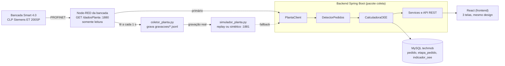

# TechMob 4.0 — Plano de alinhamento com a Bancada Smart 4.0

Atualizado em 19/11/2026 · Equipe TechMob 4.0

> Documento de referência da equipe. Cada parte da execução tem responsável, branch e PR próprios (seção **Ordem de execução**).

## Resumo

O TechMob 4.0 passa a medir a bancada como ela é: um pedido de 3 peças por vez, lido do GET /dadosPlanta do Node-RED do laboratório, sem alterar nada nele. A base continua (camadas do backend, MySQL, telas e design do frontend). Mudam três coisas: por onde o dado entra, a janela do OEE (de turno para pedido) e o conteúdo das telas.

| Eixo da demanda SAGA | Como o TechMob atende | Onde |
| :---- | :---- | :---- |
| Monitoramento de processos | Status das 3 estações (Andon) e pedido em andamento, atualizados a cada 2 s | Dashboard |
| Análise de dados | OEE por pedido (D × P × Q) e tempo de cada etapa comparado ao tempo padrão | Produção, Histórico |
| Apoio à tomada de decisão | Alerta quando o pedido passa do padrão ou o OEE fica abaixo da meta; estação gargalo em destaque | Dashboard, Produção |
| Aplicação em ambiente produtivo | Dados da Bancada Smart 4.0 real (CLP Siemens ET 200SP), gravados e reproduzidos | Coletor e replay |

Decisões já tomadas:

- **OEE por pedido**, não por turno. A fórmula é a da fábrica; muda só a janela.
- **Node-RED da bancada é só leitura.** Nada é instalado ou alterado nele.
- **O OEE é calculado em um lugar só: o backend.** O Python sai do caminho ao vivo e fica com coleta, simulação e análise.
- **Na banca, o dashboard roda com o simulador da bancada** (decisão de 19/11; antes previa o replay de uma gravação real, ver a atualização abaixo).
- **O que sai do projeto:** o flow MQTT→CSV, o broker Aedes, a simulação local do frontend (simulation.js, mockData.js) e o cálculo de 8 h fixas.

### Atualização de 19/11/2026: sem nova ida ao laboratório

Por orientação do docente, não haverá nova ida ao laboratório. A base do projeto passa a ser o que foi levantado em 14/09/2026 e a cronometragem da equipe:

- **Dado de referência:** o JSON do `/dadosPlanta` (bancada parada depois de 1 pedido), o flow do Node-RED, o CLP ET 200SP no TIA Portal e as fotos em `docs/img/`.
- **Fonte do sistema:** o simulador da bancada (`simulador_planta.py`, modo sintético), que responde o mesmo JSON com os tempos da cronometragem. É a fonte padrão e deixa de aparecer como alerta no dashboard. A leitura da bancada real continua no código (basta trocar a `PLANTA_URL`).
- **Valores definitivos:** tempo padrão de 20 s (estoque), 35 s (manipulação) e 25 s (separação), 80 s por pedido; meta de OEE de 75%; textos de status `AGUARDANDO` (lido na bancada), `PRODUZINDO` e `PARADO` (os do simulador).
- **Sem efeito:** o checklist do laboratório, as gravações reais de 3 a 5 pedidos e o replay delas na banca. Coletor e replay continuam no código.
- **Execução:** a Parte 11 recebe as fotos e a nova Parte 14 aplica a decisão (dashboard, comentários de configuração, READMEs e este plano).

## Nova arquitetura

A bancada real e o simulador entregam o mesmo JSON. O backend só troca a URL e grava a origem de cada pedido (BANCADA, REPLAY ou SINTETICO). O coletor grava as execuções reais, que o simulador reproduz na banca.

## Contrato do dado e cálculo por pedido

O contrato passa a ser o JSON que a bancada já publica. Ele é uma foto do momento, não um evento: o backend consulta a cada 1 s e descobre o pedido pelas mudanças de estado.
JSON real lido em localhost:1880/dadosPlanta (14/09, bancada parada):
`{"operacao_estoque":"AGUARDANDO", "operacao_manipulacao":"AGUARDANDO", "operacao_separacao":"AGUARDANDO", "operacao_string":"AGUARDANDO", "aguardando":1, "produzindo":0, "total_pedidos":1, "pedidos_reprovados":0, "pedidos15min":1, "Temperatura":0, "Umidade":0}`

| Campo | Tipo | Uso no TechMob |
| :---- | :---- | :---- |
| operacao_estoque, operacao_manipulacao, operacao_separacao | texto | Status de cada estação: abre e fecha as etapas do pedido |
| operacao_string | texto | Status geral, exibido no Andon |
| aguardando, produzindo | 0 ou 1 | Início e fim do pedido; os dois em 0 = parada |
| pedidos_reprovados | contador | Pedido reprovado = o contador subiu durante o pedido |
| total_pedidos, pedidos15min | contador | Só conferência; a bancada guarda só o primeiro pedido, então não é usado para contar |
| Temperatura, Umidade | número | Ignorados: chegam sempre 0, a bancada não tem esses sensores |

Regras para identificar um pedido (os textos de status são confirmados pela gravação real e ficam configuráveis):

1. **Início:** aguardando passa de 1 para 0 sem pedido aberto.
2. **Etapa:** abre quando a estação sai de AGUARDANDO e fecha quando volta. Tempo em status de parada é somado como parada da etapa.
3. **Fim:** aguardando volta para 1. O pedido é fechado e o OEE é calculado.
4. **Reprovado:** pedidos_reprovados aumentou entre o início e o fim. Se o contador diminuir, é reinício da bancada, não reprovação.
5. **Interrompido:** sem conexão por mais de 10 s com pedido aberto. O pedido é gravado como INTERROMPIDO e fica fora do OEE.

Cálculo do OEE de um pedido. L = lead time (início ao fim), T_parado = soma das paradas, T_padrão = soma do tempo padrão das etapas (cronometragem):

- D = (L − T_parado) ÷ L
- P = mín(1; T_padrão ÷ (L − T_parado))
- Q = 1 se o pedido foi aprovado, 0 se foi reprovado
- OEE = D × P × Q

Exemplo ilustrativo (tempos provisórios): padrão 80 s, pedido de 100 s com 12 s parado. Operando 88 s, D = 88%, P = 80 ÷ 88 = 90,9%, Q = 100%, OEE = 80,0%.
Para vários pedidos (Histórico, Produção), o OEE acumulado soma os tempos de todos os pedidos e aplica a mesma fórmula. Não é a média dos OEEs, que distorce quando os pedidos têm durações diferentes.

## Infra e banco (infra/schema.sql)

O banco ganha a noção de pedido e etapa; maquina e indicador_oee continuam, com ajustes. Como o backend usa ddl-auto=validate, schema e entidades JPA mudam no mesmo PR.

| Tabela | Ação | Mudança |
| :---- | :---- | :---- |
| maquina | Ajustar | capacidade_teorica vira tempo_padrao_pedido_s (soma da cronometragem). tempo_planejado_producao_s (28800, turno) vira pecas_por_pedido (3). Nova ultima_leitura_em. status_operacional passa a usar AGUARDANDO, PRODUZINDO, PARADO, SEM_CONEXAO |
| pedido | Nova (substitui historico_producao) | id, maquina_id, numero, origem (BANCADA, REPLAY, SINTETICO), situacao (EM_ANDAMENTO, CONCLUIDO, INTERROMPIDO), inicio, fim, lead_time_s, tempo_parado_s, reprovado, pecas_boas, pecas_defeituosas |
| etapa_pedido | Nova | id, pedido_id, estacao (ESTOQUE, MANIPULACAO, SEPARACAO), inicio, fim, duracao_s, tempo_parado_s, tempo_padrao_s |
| indicador_oee | Ajustar | Nova pedido_id (FK única): um indicador por pedido. periodo_inicio e periodo_fim passam a ser o início e o fim do pedido |
| historico_producao | Remover | O conceito "ciclo a ciclo" não existe na bancada |
| leitura_planta | Nova (opcional) | id, maquina_id, lido_em, payload (JSON). Guarda cada mudança lida: todo OEE pode ser rastreado até o dado bruto |

Outros ajustes no arquivo:

- Atualizar o comentário do topo: o dado bruto deixa de ser CSV e vem do /dadosPlanta.
- Índices: pedido (maquina_id, inicio DESC) e etapa_pedido (pedido_id).
- CHECK (fim >= inicio) em pedido e etapa_pedido.
- Seed da máquina 1 com tempo_padrao_pedido_s da cronometragem real e pecas_por_pedido = 3. O valor "10.0 peças/segundo" sai.
- Como o banco é local e não tem dado real ainda, a atualização é recriar: DROP DATABASE techmob; e rodar o schema.sql de novo. Isso vai no README.

## Python (data/)

O Python sai do caminho ao vivo (não grava mais no MySQL) e fica com três papéis: coletar a bancada, simulá-la e analisar as gravações. O OEE do Python passa a servir de **conferência**: para a mesma gravação, Python e Java têm que dar o mesmo número.

| Arquivo | Ação | Mudança |
| :---- | :---- | :---- |
| coletor_planta.py | Novo (pronto) | Grava o /dadosPlanta em gravacoes/*.jsonl, só nas mudanças, com horário |
| simulador_planta.py | Novo (pronto) + 1 ajuste | Serve o mesmo JSON nos modos sintetico e replay. Ajuste: enviar o cabeçalho X-TechMob-Fonte: replay ou sintetico, para o backend gravar a origem certa (o Node-RED real não envia nada = BANCADA) |
| ciclo_padrao.json | Novo (pronto) + preencher | Trocar os tempos provisórios pela cronometragem real; confirmar os textos de status com a primeira gravação |
| oee_calculator.py | Refatorar | Entrada passa a ser uma gravação .jsonl, não CSV. Detecta os pedidos com as mesmas regras do backend e calcula D, P, Q e OEE por pedido. Saída: tabela no console e `resultados/pedidos_<sessao>.csv`. Saem --watch-dir, as 8 h fixas e a gravação no MySQL |
| analisar_cronometragem.py | Novo | Lê uma ou mais gravações reais e gera o tempo padrão por etapa (mediana) para o ciclo_padrao.json, além de um relatório de gargalo (etapa com maior variação e maior atraso sobre o padrão) |
| simulador_oee.py | Remover | Substituído pelo simulador_planta.py. Os status dele (PARADA_PROGRAMADA...) não batem com a bancada |
| dados_producao_exemplo.csv | Remover | Formato antigo. O exemplo passa a ser uma gravação real em gravacoes/ |
| requirements.txt | Ajustar | Fica só pandas. SQLAlchemy e PyMySQL saem. Coletor e simulador não precisam de nada |
| tests/test_oee.py | Novo | pytest com uma gravação pequena de exemplo: pedidos detectados, pedido reprovado, pedido interrompido e o exemplo de 80,0% da seção anterior |

Também no .gitignore: trocar as linhas dos CSVs antigos por data/resultados/. As gravações reais em data/gravacoes/ **são versionadas**: são a evidência do projeto e não têm dado pessoal.

## Node-RED (node-red/)

O nosso Node-RED deixa de ter função: a fonte é o Node-RED da bancada, que só pode ser lido. A pasta fica, mas passa a **documentar** o Node-RED da bancada em vez de rodar um.

| Arquivo | Ação | Mudança |
| :---- | :---- | :---- |
| flows.json | Remover | Flow MQTT in → valida → grava CSV, que não tem origem de dados |
| package.json, package-lock.json | Remover | node-red e node-red-contrib-aedes não são mais usados |
| settings.js | Remover | Configuração do Node-RED local |
| start-node-red.cmd (raiz) | Remover | Script que subia o Node-RED local |
| README.md | Novo | O que existe na bancada: abas CLP_MQTT (CLP → funções de status → TagoIO), ServidorSiemens e API_Dados_Planta (GET /dadosPlanta → leDadosPlanta → resposta HTTP). Endereço, porta 1880, o JSON e a regra "somente leitura" |
| fotos/ | Nova | As fotos do flow, do JSON no navegador e do painel elétrico (ET 200SP), usadas no README e nos slides |

Por que consultar e não assinar MQTT: o único MQTT da bancada é de saída para o TagoIO (nó CLP_TAGO, parado em "connecting" porque a nuvem não é acessível). Publicar para nós exigiria alterar o flow, o que não é permitido.

## Backend (backend/)

As camadas Controller → Service → Repository → DTO continuam. O backend deixa de ser só leitura: ganha um pacote coleta que consulta a bancada, identifica os pedidos e calcula o OEE. As regras de negócio ficam em duas classes puras (sem Spring), fáceis de testar.
Arquivos em src/main/java/com/toyota/techmob/backend/:

| Pacote / arquivo | Ação | Mudança |
| :---- | :---- | :---- |
| BackEndApplication | Ajustar | @EnableScheduling e @ConfigurationPropertiesScan |
| config/PlantaProperties | Novo | @ConfigurationProperties("techmob.planta"): url, urlFallback, intervaloMs, timeoutMs, segundosSemConexao, textos de status (statusParado, statusParada), metaOee |
| config/CorsConfig | Ajustar | Liberar só GET e OPTIONS |
| coleta/LeituraPlanta | Novo | record espelho do JSON da bancada (@JsonProperty("Temperatura") etc.) |
| coleta/PlantaClient | Novo | RestClient com timeout e sem proxy. Tenta a url; depois de 3 falhas seguidas usa a urlFallback (simulador). Lê o cabeçalho X-TechMob-Fonte para saber a origem. JSON inválido conta como falha |
| coleta/DetectorPedidos | Novo (classe pura) | Máquina de estados das regras da seção de contrato: recebe uma leitura e devolve eventos (pedido iniciado, etapa fechada, pedido concluído, interrompido) |
| coleta/CalculadoraOEE | Novo (classe pura) | D, P, Q e OEE de um pedido e de um conjunto de pedidos (somando tempos) |
| coleta/ColetorPlanta | Novo | @Scheduled(fixedDelayString = "${techmob.planta.intervalo-ms}"): lê, passa ao detector, guarda o estado atual em memória e chama o serviço de registro nos eventos. Desligado nos testes (techmob.coleta.habilitada=false) |
| coleta/EstadoPlantaAtual | Novo | Estado ao vivo em memória (AtomicReference): status das estações, pedido em andamento, fonte, última leitura |
| domain/Maquina | Ajustar | Campos novos do schema (tempoPadraoPedidoS, pecasPorPedido, ultimaLeituraEm) |
| domain/HistoricoProducao | Renomear → Pedido | Campos da tabela pedido; @OneToMany para EtapaPedido |
| domain/EtapaPedido | Novo | Entidade da tabela etapa_pedido; enum Estacao |
| domain/IndicadorOEE | Ajustar | @OneToOne com Pedido |
| repository/* | Ajustar / novo | PedidoRepository (por máquina e intervalo de datas), EtapaPedidoRepository; HistoricoProducaoRepository sai |
| service/RegistroPedidoService + Impl | Novo | @Transactional (escrita): grava pedido, etapas e indicador de uma vez; atualiza status_operacional e ultima_leitura_em da máquina |
| service/PedidoService + Impl | Novo (substitui HistoricoProducaoService) | Lista pedidos com filtro de datas e origem; detalhe com etapas; resumo do período |
| service/MaquinaServiceImpl | Ajustar | buscarDashboard passa a juntar indicador do último pedido, estado ao vivo, resumo do dia e meta |
| dto/* | Ajustar / novo | DashboardResponseDTO ganha planta, resumoHoje e metaOee. MaquinaDTO ganha ultimaLeituraEm. IndicadorOEEDTO ganha pedidoId, periodoInicio, periodoFim. Novos: PedidoDTO, PedidoDetalheDTO, EtapaPedidoDTO, StatusPlantaDTO, ResumoPedidosDTO. HistoricoProducaoDTO sai |
| mapper/DtoMapper | Ajustar | Conversões dos DTOs novos |
| controller/HistoricoProducaoController | Substituir → PedidoController | Endpoints de pedidos (tabela abaixo) |
| controller/PlantaController | Novo | Estado ao vivo, lido a cada 2 s pelo frontend |
| exception/GlobalExceptionHandler | Corrigir | NoResourceFoundException → 404, MethodArgumentTypeMismatchException → 400, novo PedidoNotFoundException → 404. O 500 genérico registra o erro no log e devolve mensagem fixa, sem ex.getMessage() |

Contrato da API depois da mudança (todos GET):

| Endpoint | Retorna | Situação |
| :---- | :---- | :---- |
| /api/maquinas | Lista de máquinas | Mantém |
| /api/dashboard/{maquinaId} | Máquina, OEE do último pedido, estado ao vivo, resumo de hoje, meta | Ampliado |
| /api/planta/{maquinaId}/status | Estações, pedido em andamento, fonte, conexão | Novo |
| /api/pedidos/{maquinaId}?de=&ate=&origem= | Pedidos do período com OEE | Novo (substitui /api/historico-producao) |
| /api/pedidos/detalhe/{pedidoId} | Pedido com etapas e tempo padrão | Novo |
| /api/indicadores/historico/{maquinaId} | Série de OEE por pedido | Mantém |
| /actuator/health | Saúde da API | Mantém |

application.properties ganha o bloco techmob.*, todos com variável de ambiente e padrão: PLANTA_URL (padrão http://localhost:1880/dadosPlanta), PLANTA_URL_FALLBACK (http://localhost:1881/dadosPlanta), PLANTA_INTERVALO_MS (1000), META_OEE (75).
Testes:

- **Novos unitários:** CalculadoraOEETest (exemplo de 80,0%, reprovado = 0%, performance limitada a 100%, acumulado por soma de tempos) e DetectorPedidosTest, alimentado por uma gravação real em src/test/resources/gravacoes/.
- **PlantaClientTest** com MockRestServiceServer: resposta normal, JSON inválido, queda e troca para o fallback.
- **Ajustar** ApiContratoIntegrationTest para os contratos novos e incluir 404 de rota inexistente e 400 de id inválido.
- **Trocar** HistoricoProducaoServiceImplTest por PedidoServiceImplTest.
- **Avisos atuais:** remover o H2Dialect explícito do teste e configurar o agente do Mockito no maven-surefire-plugin (aviso do JDK 25).

## Frontend (frontend/)

O design fica igual: mesmos componentes (KpiCard, Panel, StatCard, SummaryDonut, Pagination, PageHeader), mesmos CSS e tokens do global.css, mesmas três telas. Muda o que cada painel mostra e de onde vem o dado: tudo passa a vir da API. A simulação sai do navegador e vai para o backend (simulador), então o frontend sempre mostra a mesma coisa que o banco.

### Dashboard (pages/Dashboard.jsx)

| Painel atual | Passa a mostrar |
| :---- | :---- |
| 4 KpiCard (OEE, D, P, Q) | Os 4 do **último pedido concluído**. Legendas reais: meta vinda da API; tempo parado; lead time contra o padrão; pedido aprovado ou reprovado. Setas de tendência contra a média dos últimos 10 pedidos (saem os 90/85/98 fixos) |
| TENDÊNCIA – Evolução do OEE (TrendChart) | OEE **pedido a pedido**. O seletor "Últimas 24h / 7 dias" vira "Últimos 10 / 20 / 50 pedidos" |
| STATUS DA LINHA | **Andon**: as 3 estações com o ponto de status (verde operando, cinza aguardando, vermelho parado), o pedido em andamento, a etapa atual e o tempo decorrido contra o padrão. Métricas: pedidos hoje, aprovados, lead time médio |
| Banner "Modo de demonstração" | Mesmo estilo, dois casos: API fora do ar (usa o ErrorState que já existe) e bancada sem conexão ("exibindo replay" ou "exibindo simulação") |

Saem os valores fixos: "Meta do turno: 75%", "7h 22min", "12,8 s", "un/h" e a série de 12 horas no código. Corrige o bug simulationState ?? data.

### Produção (pages/Producao.jsx)

| Painel atual | Passa a mostrar |
| :---- | :---- |
| 4 StatCard | Pedidos concluídos, peças produzidas (pedidos × 3), pedidos reprovados, taxa de reprovação |
| Seletor 1H…30D | Hoje / 7D / 30D / Tudo |
| PRODUÇÃO AO LONGO DO TEMPO (ComposedChart) | Um grupo por pedido: barras empilhadas com o tempo de cada etapa (estoque, manipulação, separação) e a linha do tempo padrão. Mostra onde o pedido atrasou |
| RESUMO (SummaryDonut) | Pedidos aprovados × reprovados; rodapé com lead time médio |
| PRODUÇÃO POR HORA (BarChart) | **Tempo médio por etapa × padrão**: duas barras por estação. A estação com maior diferença recebe o selo "gargalo" |

### Histórico (pages/Historico.jsx)

| Painel atual | Passa a mostrar |
| :---- | :---- |
| 4 StatCard | Pedidos, OEE acumulado (por soma de tempos), lead time médio, taxa de reprovação |
| Filtros | Período (fica); "Agrupar por" Pedido / Hora / Dia (sai Turno); "Filtro rápido" vira Origem (Todas, Bancada, Replay, Simulação) |
| Tabela | Uma linha por pedido: número, data e hora, origem, lead time, tempo parado, D, P, Q, OEE, ponto de status (meta) |
| Botão › de cada linha (hoje sem ação) | Abre o detalhe do pedido: linha do tempo das 3 etapas contra o padrão, usando Panel e as cores existentes |

Corrige o useMemo que nunca reaproveita (sourceRows recriado a cada render) e o agrupamento, que passa a somar tempos em vez de tirar média de OEE.

### Arquivos compartilhados

| Arquivo | Ação | Mudança |
| :---- | :---- | :---- |
| App.jsx | Ajustar | Sai a simulação de 4 s e o simulationState. O AppLayout consulta /api/planta/1/status a cada 2 s e repassa para Topbar, Sidebar e telas |
| components/Topbar.jsx | Ajustar | O selo "MQTT conectado" vira "Bancada conectada", "Replay" ou "Simulação", vindo da API (mesma classe CSS). O botão "Ativar simulação" sai: a fonte é escolhida ao subir o backend |
| components/Sidebar.jsx | Ajustar | Cartão "MÁQUINA" com o status real: Operando, Aguardando, Parada ou Sem conexão |
| components/PageHeader.jsx | Corrigir | Relógio atualiza a cada 1 s |
| services/machineService.js | Ajustar | Novas buscarStatusPlanta, listarPedidos, buscarPedido; sai buscarHistoricoProducao |
| services/adapters.js | Reescrever | Um adapter por DTO real, sem os campos adivinhados (tendenciaOee, resumo24h, dataHora...) |
| hooks/usePolling.js | Ajustar | Intervalo configurável por VITE_POLLING_MS; mantém o último dado enquanto recarrega |
| data/simulation.js, data/mockData.js | Remover | Dado inventado no navegador |
| .env.example | Ajustar | VITE_API_URL, VITE_MAQUINA_ID, VITE_POLLING_MS; sai a menção ao Render |

## Documentação e apresentação

A narrativa fica CONTEXTO → PROBLEMA → SOLUÇÃO → CONCLUSÃO, com o software como solução: ele monitora, analisa e apoia a decisão na bancada real. As fotos do laboratório entram como prova.
READMEs:

| Arquivo | Mudança |
| :---- | :---- |
| README.md (raiz) | Arquitetura nova; "Como rodar" com 4 passos (banco, fonte de dados = bancada ou simulador, backend, frontend); portas (1880 bancada/simulador, 1881 fallback, 8080, 5173; sai a 1883); pendências atualizadas |
| backend/README.md | Pacote coleta, propriedades techmob.*, endpoints novos, como rodar contra o simulador |
| frontend/README.md | Telas novas, fonte do dado, variáveis VITE_* |
| data/README.md (novo) | Coletor, simulador (sintético e replay), análise e a fórmula do OEE por pedido |
| node-red/README.md (novo) | Node-RED da bancada, somente leitura (seção Node-RED) |

Slides:

| Slide | Hoje | Passa a ser |
| :---- | :---- | :---- |
| 4 – Solução | Equipamento, indicador, conhecimento | Igual, com a foto da bancada e "OEE por pedido" no indicador |
| 5 – Arquitetura | Diagrama quebrado (texto espremido) com MQTT e CSV | Refazer com o fluxo novo da seção Arquitetura |
| 6 – Integração | Contrato vazio e selo "ainda sem publicação" | JSON real, foto do flow API_Dados_Planta e selo "lendo a bancada" |
| 7 – OEE | Exemplo 90% × 85% × 95% | Exemplo de um pedido real (tempos da gravação) |
| 8 – Back-end | 4 endpoints, 17 testes, 3 tabelas | Atualizar os números no fim da implementação |
| 10 – Cenário | Alerta → Produção → Histórico, "dados simulados" | Andon mostra pedido acima do padrão → Produção aponta a etapa gargalo → Histórico mostra se repete. Selo "dados reais da bancada" |
| 11 – Restrições | "Toda fonte de dados é simulada" | "Dados de uma bancada didática, nenhum dado industrial"; acrescentar "Node-RED da bancada somente leitura" |
| 12 – Conclusão | "O caminho está pronto. Falta a bancada." | "A bancada já fala com o sistema." |

Vídeos:

- **Banca (3 a 5 min):** gravação no laboratório da bancada executando um pedido, em paralelo com o dashboard ao vivo. No auditório, a demonstração roda em replay dessa mesma execução.
- **SAGA (~1:30):** cortes da bancada, do Andon e do OEE do pedido.

## Equipe e responsabilidades

| Integrante | GitHub | Função no projeto |
| :---- | :---- | :---- |
| Lucas Nunes Patracão | [@lucaspatracao](https://github.com/lucaspatracao) | Integração com a Bancada Smart 4.0, base do projeto e coordenação |
| Rafael Rubiá Oliveira Cardoso | [@rafarubia7](https://github.com/rafarubia7) | Banco de dados, entidades, API e testes |
| Otávio Pinheiro Garcia | [@otaviopgarcia](https://github.com/otaviopgarcia) | Front-end e automação da Smart 4.0 |
| Nykolas Guimarães Isler | [@NykolasDev](https://github.com/NykolasDev) | Front-end e documentação |
| Samuel Santana Campos | [@Sah123campos](https://github.com/Sah123campos) | Python, simulação de dados, dashboard e testes |

## Ordem de execução

Cada parte é uma branch e um PR, no nome de quem é responsável por ela. As branches formam uma cadeia: cada uma sai da anterior e o PR aponta para ela, então os PRs são revisados e mesclados **na ordem da tabela**. Ao mesclar um PR e apagar a branch, o GitHub redireciona o próximo para a `main`.

| Parte | Responsável | Branch | Entrega | Verificação |
| :---- | :---- | :---- | :---- | :---- |
| 1 | Lucas | `docs/plano-alinhamento` | Este plano em `docs/PLANO_ALINHAMENTO.md` | Leitura |
| 2 | Lucas | `feat/coleta-bancada` | `data/coletor_planta.py`, `data/simulador_planta.py`, `data/ciclo_padrao.json` | Simulador + coletor rodando juntos |
| 3 | Rafael | `feat/contrato-pedido` | `infra/schema.sql`, entidades, repositórios, DTOs, `DtoMapper` e exemplos de JSON de cada endpoint no `backend/README.md` | `mvnw test` |
| 4 | Samuel | `feat/analise-pedidos` | Cabeçalho `X-TechMob-Fonte` no simulador, `oee_calculator.py` refatorado, `analisar_cronometragem.py`, `requirements.txt`, `data/tests/` | `pytest` |
| 5 | Lucas | `feat/coleta-backend` | `PlantaProperties`, pacote `coleta`, `RegistroPedidoService`, `application.properties`, testes | `mvnw test` |
| 6 | Rafael | `feat/api-pedidos` | `PedidoService`, `MaquinaService`, `PedidoController`, `PlantaController`, `GlobalExceptionHandler`, `CorsConfig`, testes de contrato | `mvnw test` |
| 7 | Otávio | `feat/front-api-real` | `machineService`, `adapters`, `usePolling`, `App`, `Topbar`, `Sidebar`, `PageHeader`, `.env.example` | `npm run build` |
| 8 | Samuel | `feat/front-dashboard` | Tela Dashboard | `npm run build` |
| 9 | Otávio | `feat/front-producao` | Tela Produção | `npm run build` |
| 10 | Nykolas | `feat/front-historico` | Tela Histórico e detalhe do pedido | `npm run build` |
| 11 | Otávio | `docs/node-red-bancada` | `node-red/README.md` e `node-red/fotos/` (Node-RED da bancada, somente leitura) | Leitura |
| 12 | Lucas | `chore/remove-fluxo-antigo` | Remoção do fluxo antigo (Node-RED local, `simulador_oee.py`, CSV de exemplo, mocks do frontend) | `mvnw test`, `npm run build`, `pytest` |
| 13 | Nykolas | `docs/readmes-alinhamento` | `README.md` da raiz, `backend/README.md`, `frontend/README.md` e `data/README.md` | Leitura |
| 14 | Lucas | `feat/simulacao-como-fonte` | Decisão de 19/11: simulador como fonte padrão (sem alerta no dashboard), valores definitivos e documentação atualizada | `mvnw test`, `npm run build`, `pytest` |

Fora do código: slides e vídeos. (As gravações reais no laboratório foram canceladas em 19/11.)

Regras para cada parte:

1. A branch sai da branch da parte anterior (a parte 1 sai da `main` atualizada).
2. Cada branch compila e passa nos testes sozinha. Se uma mudança obrigar a ajustar código de outra parte para compilar, o ajuste mínimo entra na parte atual.
3. Commits pequenos, em português, no padrão `tipo(escopo): descrição` (ex.: `feat(coleta): detecta pedidos pelas transições do /dadosPlanta`), no nome e e-mail do responsável pela parte.
4. O PR descreve o que mudou e como testar, e precisa da revisão de pelo menos uma pessoa de outra parte. O responsável pela parte revisa e aprova o próprio conteúdo antes do merge.

Valores do projeto (definitivos desde 19/11): tempo padrão de 80 s por pedido (20 s estoque, 35 s manipulação, 25 s separação, em `ciclo_padrao.json` e no seed) e meta de OEE de 75% (variável `META_OEE`). Os textos de status além de `AGUARDANDO` são os do simulador e ficam configuráveis.

## Checklist do dia no laboratório

> **Cancelado em 19/11/2026:** não haverá nova ida ao laboratório (ver a atualização no início). Mantido como registro.

O objetivo da visita é sair com gravações reais de 3 a 5 pedidos, sem alterar nada na bancada. O JSON só existe com a bancada ligada.

- [ ] Antes: testar o kit em casa (simulador + coletor) e levar o repositório atualizado no notebook
- [ ] Com a bancada ligada, anotar o IP do notebook do laboratório (ipconfig; a rede vista nas fotos é 192.168.160.x)
- [ ] Conectar o nosso notebook na mesma rede e abrir `http://<IP>:1880/dadosPlanta` no navegador
- [ ] Se abrir: rodar `python data/coletor_planta.py --url http://<IP>:1880/dadosPlanta`
- [ ] Se o firewall bloquear: pedir ao professor para rodar o coletor no próprio notebook do laboratório (só lê localhost)
- [ ] Executar de 3 a 5 pedidos, com pelo menos um reprovado se a bancada permitir
- [ ] Filmar cada pedido (conferência dos tempos e material para os vídeos)
- [ ] Encerrar com Ctrl+C e fotografar o resumo: é a lista real dos textos de status
- [ ] Ver o que é 192.168.160.100:5050/requests e anotar
- [ ] Copiar as gravações para data/gravacoes/ e fazer o commit no mesmo dia

## Riscos e pendências

| Risco | Efeito | O que fazer |
| :---- | :---- | :---- |
| Textos de status diferentes do previsto (só AGUARDANDO é confirmado) | Detector não abre ou fecha etapas | Textos ficam em techmob.planta.* e no ciclo_padrao.json; ajustar com o resumo da primeira gravação |
| Firewall bloqueia o acesso de outro notebook | Sem gravação real | Coletor no notebook do laboratório, com autorização do professor |
| Bancada desligada no dia da banca | Sem dado ao vivo | Replay de gravação real (já é o plano) |
| Node-RED devolve JSON inválido quando uma variável global está indefinida | Leitura perdida | Cliente trata como falha e o coletor guarda o texto bruto |
| Contadores da bancada reiniciam ("só guarda o primeiro pedido") | Contagem errada | Pedido contado pelas transições; contadores usados só como diferença |
| Qualidade só por pedido (aprovado ou reprovado) | Pedido reprovado tem OEE 0% | Explicar na apresentação; refinar se a bancada informar reprovação por peça |
| Calendário (conclusão em dezembro de 2026) | Falta de tempo | Itens opcionais ficam por último: tabela leitura_planta e detalhe do pedido no Histórico |

Pendências abertas (atualizadas em 19/11):

- ~~Tempos da cronometragem~~: definidos (20/35/25 s, 80 s por pedido).
- ~~Data da próxima ida ao laboratório~~: cancelada. Falta só a data da banca.
- ~~Valor da meta de OEE~~: mantida em 75%.
- Slides e vídeos: o material passa a ser o dashboard rodando com o simulador e as fotos de 14/09. Ajustar os slides que citavam gravação real (7 – OEE, 10 – Cenário e 12 – Conclusão).
