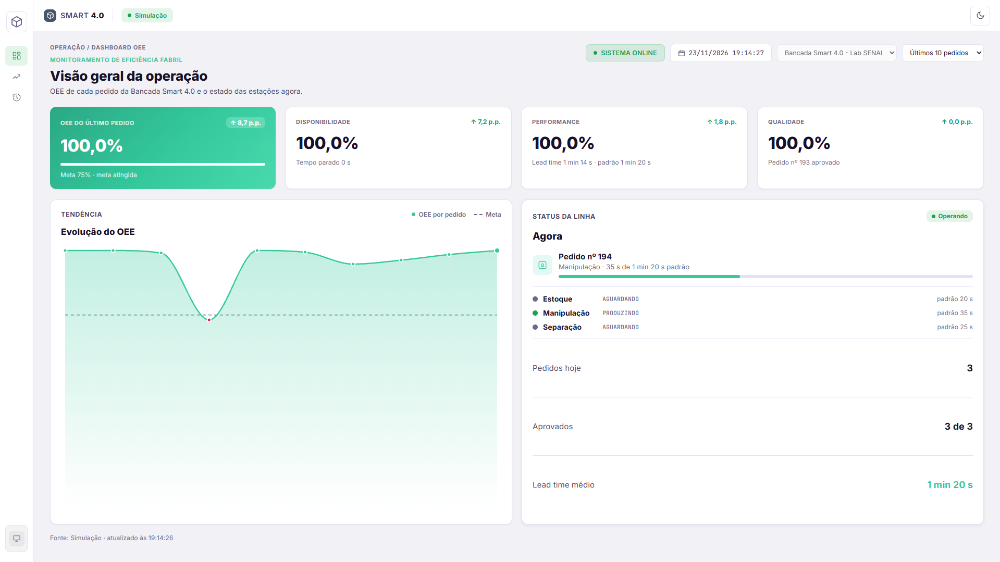
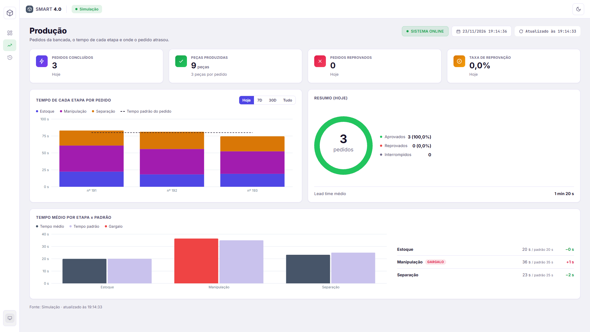
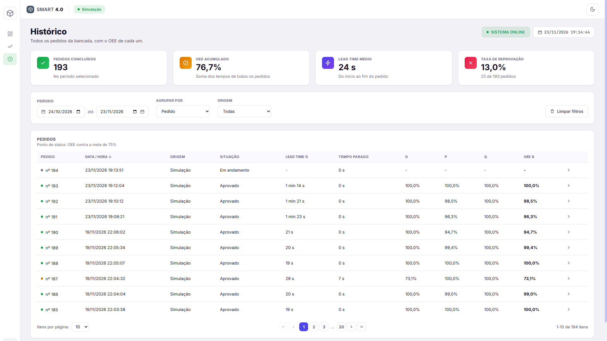

# SMART 4.0 — Frontend (TechMob 4.0)

Dashboard web (Vite + React) que mostra a Bancada Smart 4.0 pedido a pedido: o estado das estações agora, o OEE de cada pedido e onde o pedido atrasou. Projeto TechMob 4.0 (Fundação Toyota do Brasil / SENAI-SP).

**Todo dado vem da API** (o backend Spring Boot, ver [`backend/README.md`](../backend/README.md)). O frontend não gera nem simula nada: quando não há bancada, quem simula é o backend, lendo o `data/simulador_planta.py`. Assim a tela sempre mostra o que está no banco.

## Como rodar

```powershell
cd frontend
npm install
copy .env.example .env   # opcional: só se a API não estiver em localhost:8080
npm run dev
```

Abra http://localhost:5173. O backend precisa estar rodando (e liberado para essa origem no CORS: `localhost:5173` e `localhost:3000`).

| Variável (`.env`) | Padrão | Para quê |
|---|---|---|
| `VITE_API_URL` | `http://localhost:8080` | Endereço da API |
| `VITE_MAQUINA_ID` | `1` | Máquina consultada (o seed do `schema.sql` cria a Bancada Smart 4.0 com `id = 1`) |
| `VITE_POLLING_MS` | `2000` | Intervalo entre as consultas, em ms. O backend lê a bancada a cada 1 s |

### Build de produção

```powershell
npm run build     # gera dist/
npm run preview   # serve o build em http://localhost:4173
```

A pasta `dist/` é gerada a cada build e **não é versionada**. O build separa as bibliotecas em arquivos próprios (`react-*.js`, `charts-*.js`), que o navegador mantém em cache: uma mudança no código da aplicação só faz baixar de novo o `index-*.js`.

## Telas

### Dashboard



| Painel | O que mostra | Endpoint |
|---|---|---|
| 4 cards (OEE, Disponibilidade, Performance, Qualidade) | Os do **último pedido concluído**, com a meta, o tempo parado, o lead time contra o padrão e se o pedido foi aprovado. As setas comparam com a média dos 10 pedidos anteriores | `/api/dashboard/{id}`, `/api/pedidos/detalhe/{id}` |
| Tendência | OEE pedido a pedido (últimos 10, 20 ou 50), com a meta tracejada e os pedidos abaixo dela em vermelho | `/api/indicadores/historico/{id}` |
| Status da linha (Andon) | As 3 estações (verde operando, cinza aguardando, vermelho parado), o pedido em andamento com a etapa atual e o tempo decorrido contra o padrão, a estação que mais atrasou no último pedido e os números de hoje | `/api/dashboard/{id}` |
| Aviso | Só quando falta dado: API fora do ar ou fonte sem conexão | `/api/dashboard/{id}` |

### Produção



Seletor Hoje / 7D / 30D / Tudo (`/api/pedidos/{id}?de=`).

| Painel | O que mostra |
|---|---|
| 4 cards | Pedidos concluídos, peças produzidas (3 por pedido), pedidos reprovados e taxa de reprovação |
| Tempo de cada etapa por pedido | Um grupo por pedido: barras empilhadas (estoque, manipulação, separação) e a linha do tempo padrão. Mostra onde o pedido atrasou |
| Resumo | Pedidos aprovados x reprovados, interrompidos e lead time médio |
| Tempo médio por etapa x padrão | Duas barras por estação; a que mais passa do padrão ganha o selo **gargalo** |

### Histórico



Filtros: período, agrupar por Pedido / Hora / Dia e origem (Bancada, Replay, Simulação), todos enviados à API (`/api/pedidos/{id}?de=&ate=&origem=`).

- **4 cards:** pedidos concluídos, OEE acumulado, lead time médio e taxa de reprovação.
- **Tabela:** uma linha por pedido, com número, data e hora, origem, situação, lead time, tempo parado, D, P, Q, OEE e o ponto de status contra a meta (verde atingiu, laranja até 10 p.p. abaixo, vermelho abaixo disso).
- **Detalhe (botão ›):** a linha do tempo das 3 etapas do pedido, cada uma contra o tracejado do tempo padrão, com o tempo parado em destaque (`/api/pedidos/detalhe/{id}`).

Agrupado por hora ou dia, e no card de OEE acumulado, o OEE **soma os tempos** dos pedidos e aplica a fórmula uma vez, a mesma conta do backend (`src/services/resumoPedidos.js`). Não é a média dos OEEs.

### Em todas as telas

O layout consulta `/api/planta/{id}/status` a cada `VITE_POLLING_MS` e mostra:

- **Selo da barra superior:** a fonte do dado (Bancada conectada, Replay, Simulação, Bancada sem conexão ou API fora do ar).
- **Cartão MÁQUINA da barra lateral:** Operando, Aguardando, Parada ou Sem conexão.

Se a API cair, cada tela continua com o último dado recebido e avisa.

## Integração com a API

A camada de acesso fica em `src/services/`:

| Arquivo | Papel |
|---|---|
| `api.js` | Instância do Axios (`baseURL` vem de `VITE_API_URL`, timeout de 10 s) |
| `machineService.js` | Uma função por endpoint; devolve o JSON exatamente como a API envia |
| `adapters.js` | Um adapter por DTO da API: datas viram `Date`, códigos ganham rótulo em português. Também tem a formatação pt-BR (`formatarPercentual`, `formatarDuracao`...) |
| `resumoPedidos.js` | Resumo e OEE acumulado de um conjunto de pedidos (mesma conta do backend) |

O hook `usePolling` (`src/hooks/`) consulta de novo só depois que a resposta anterior chega e mantém o último dado enquanto recarrega ou quando uma consulta falha.

O contrato completo da API, com exemplos de resposta, está em [`backend/README.md`](../backend/README.md#endpoints).

## Estrutura de pastas

```
frontend/
├─ index.html                 # página base (favicon: /logo-smart.svg)
├─ vite.config.js             # porta 5173 + divisão do bundle
├─ public/
│  └─ logo-smart.svg
└─ src/
   ├─ main.jsx                # bootstrap do React
   ├─ App.jsx                 # layout, rotas, tema claro/escuro e estado ao vivo da bancada
   ├─ components/
   │  ├─ Sidebar.jsx          # menu lateral e cartão MÁQUINA
   │  ├─ Topbar.jsx           # barra superior: fonte do dado e tema
   │  ├─ PageHeader.jsx       # cabeçalho de cada página (título, status, relógio)
   │  ├─ Panel.jsx            # card genérico usado por gráficos e tabelas
   │  ├─ StatCard.jsx         # card de indicador numérico
   │  ├─ SummaryDonut.jsx     # anel aprovados x reprovados
   │  ├─ StateFeedback.jsx    # estados de carregando e erro
   │  └─ Pagination.jsx       # paginação da tabela do Histórico
   ├─ pages/
   │  ├─ Dashboard.jsx
   │  ├─ Producao.jsx
   │  └─ Historico.jsx
   ├─ services/               # api.js, machineService.js, adapters.js, resumoPedidos.js
   ├─ hooks/
   │  └─ usePolling.js        # consulta periódica, com loading, erro e último dado
   └─ styles/                 # um CSS por componente/página + global.css (tokens de cor)
```

## Decisões de interface

- O design (componentes, CSS e tokens do `global.css`) é o mesmo das versões anteriores; mudou o que cada painel mostra.
- As cores das estações nos gráficos (azul estoque, roxo manipulação, laranja separação) são as mesmas na Produção e no detalhe do Histórico.
- O relógio do cabeçalho mostra a hora do navegador e atualiza a cada segundo; "hoje" no Dashboard é o dia no fuso do servidor.
- O ícone da bancada na sidebar foi recriado em SVG, porque o original não estava disponível isolado.
