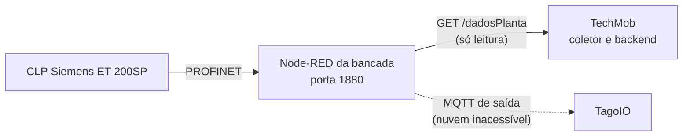

# Node-RED da Bancada Smart 4.0 (somente leitura)

A Bancada Smart 4.0 do laboratório tem um Node-RED próprio, que conversa com o CLP. É dele que o TechMob tira o dado: uma consulta `GET /dadosPlanta` na porta 1880, a cada 1 segundo.

**O TechMob só lê esse Node-RED.** Nada é instalado, importado ou alterado nele, e o projeto não roda um Node-RED próprio. Esta pasta existe para documentar o da bancada.



## Onde fica

| Item | Valor |
|---|---|
| Equipamento | Bancada Smart 4.0, CLP Siemens ET 200SP, ligado por PROFINET |
| Node-RED | No notebook do laboratório, porta `1880` |
| Rede | `192.168.160.x` (vista no laboratório) |
| O que o TechMob lê | `GET http://<IP do notebook>:1880/dadosPlanta` |

O JSON só existe com a bancada ligada. Para conferir, abra o endereço no navegador de um computador na mesma rede.

## Abas do flow

| Aba | O que faz | Uso no TechMob |
|---|---|---|
| `API_Dados_Planta` | `GET /dadosPlanta` → função `leDadosPlanta` → resposta HTTP com o JSON abaixo | É a única coisa que o TechMob consulta |
| `CLP_MQTT` | CLP → funções de status → envio por MQTT ao TagoIO (nó `CLP_TAGO`) | Nenhum. O nó fica em "connecting": a nuvem não é acessível do laboratório |
| `ServidorSiemens` | Aba do flow ligada ao CLP Siemens (função exata a confirmar na próxima visita) | Nenhum |

### Por que consultar e não assinar MQTT

O único MQTT da bancada é de **saída**, para o TagoIO. Para o Node-RED publicar para o TechMob, seria preciso alterar o flow, e o flow não pode ser alterado. Por isso o TechMob consulta o `/dadosPlanta`, que já existe, a cada segundo.

## O JSON

Lido em `localhost:1880/dadosPlanta` em 14/09, com a bancada parada:

```json
{
  "operacao_estoque": "AGUARDANDO",
  "operacao_manipulacao": "AGUARDANDO",
  "operacao_separacao": "AGUARDANDO",
  "operacao_string": "AGUARDANDO",
  "aguardando": 1,
  "produzindo": 0,
  "total_pedidos": 1,
  "pedidos_reprovados": 0,
  "pedidos15min": 1,
  "Temperatura": 0,
  "Umidade": 0
}
```

É uma **foto do momento**, não um evento: o TechMob descobre o pedido pelas mudanças entre uma leitura e a seguinte.

| Campo | Tipo | Uso no TechMob |
|---|---|---|
| `operacao_estoque`, `operacao_manipulacao`, `operacao_separacao` | texto | Status de cada estação: abre e fecha as etapas do pedido |
| `operacao_string` | texto | Status geral, exibido no Andon |
| `aguardando`, `produzindo` | 0 ou 1 | Início e fim do pedido; os dois em 0 = parada |
| `pedidos_reprovados` | contador | Pedido reprovado = o contador subiu durante o pedido |
| `total_pedidos`, `pedidos15min` | contador | Só conferência; a bancada guarda só o primeiro pedido, então não serve para contar |
| `Temperatura`, `Umidade` | número | Ignorados: chegam sempre 0, a bancada não tem esses sensores |

Só o texto `AGUARDANDO` está confirmado. Os outros textos de status (`PRODUZINDO`, `PARADO`...) ficam configuráveis no backend (`techmob.planta.*`) e no `data/ciclo_padrao.json`, e são conferidos com o resumo que o coletor mostra ao encerrar.

## Como o TechMob usa

| Quem | Como | Detalhe |
|---|---|---|
| `data/coletor_planta.py` | `python data/coletor_planta.py --url http://<IP>:1880/dadosPlanta` | Grava as mudanças em `data/gravacoes/*.jsonl`. `Ctrl+C` encerra e mostra o resumo dos status |
| Backend | Variável `PLANTA_URL` (padrão `http://localhost:1880/dadosPlanta`) | Consulta a cada 1 s. Depois de 3 falhas seguidas, lê o simulador (`PLANTA_URL_FALLBACK`) |
| `data/simulador_planta.py` | Mesma rota e mesmo JSON (porta 1881 quando usado como fallback) | Reproduz uma gravação real (replay) quando a bancada não está disponível |

Se o firewall do notebook do laboratório bloquear o acesso de outro computador, o coletor roda no próprio notebook do laboratório, lendo `localhost`, com autorização do professor.

## Cuidados conhecidos

| Situação | Efeito | Como o TechMob trata |
|---|---|---|
| Variável global ainda indefinida no Node-RED (bancada recém-ligada) | O `/dadosPlanta` devolve JSON inválido | O backend conta como falha de leitura; o coletor guarda o texto bruto |
| Contadores reiniciam ("a bancada guarda só o primeiro pedido") | `total_pedidos` não serve para contar | Pedido contado pelas transições; contadores usados só como diferença |
| Contador de reprovados diminui | Reinício da bancada | Não conta como reprovação |
| `192.168.160.100:5050/requests` | Endereço visto no laboratório, função desconhecida | A investigar na próxima visita |

## Fotos

As fotos do laboratório ficam em [`fotos/`](fotos/). A lista do que fotografar está em [`fotos/README.md`](fotos/README.md).
